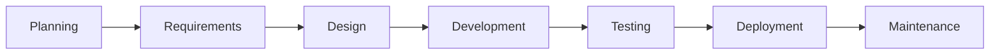

# Spec Kit이 Spec Kit을 개발하는 방법: 에이전트 기반 SDLC

Spec Kit 자체의 개발은 에이전트 기반 작업과 전통적인 소프트웨어 전달을
결합합니다. 에이전트는 기능 요청을 평가하고, 규모 있는 변경의 개발을 돕고, 보고된
버그를 조사합니다. 프로젝트는 프로세스가 맞는 곳에서는 Spec Kit 자체도 사용합니다.
한편 결정적인 테스트와 릴리스는 일반적인 GitHub Actions로 남아 있고, 진행하거나
병합할지에 대한 결정은 메인테이너가 내립니다.

공개 워크플로와 과거의 한 기능이 이 사례 연구의 근거를 제공합니다. 이들은
프로젝트의 SDLC를 지나는 서로 다른 경로와, 프로젝트가 Spec Kit 자체를 사용하는
지점을 보여 줍니다.

## 프로젝트의 소프트웨어 개발 수명 주기

전통적인 단계들은 프로젝트의 실무가 SDLC의 어디에 위치하는지 알려 줍니다.

이 단계들은 지도이지 필수 순서가 아닙니다. 작업은 출발 자료와 목표가 요구하는
곳 어디에서든 시작할 수 있습니다. 기능 요청은 계획에서, 기존 변경은 테스트에서,
버그 보고는 유지 보수에서 시작합니다. 단계는 겹치거나 반복되거나 생략될 수
있습니다. 하나의 기능 이슈가 평가의 입력이 되고, 요구사항을 기록하고, 설계 논의를
담을 수 있습니다. 화살표는 익숙한 경로 하나를 보여 줄 뿐, SDLC 단계 사이의 필수
전환이 아닙니다. 유지 보수에서 나온 피드백은 다음 계획 주기에 반영될 수 있습니다.

## 누가 작업을 하는가

아래 방식들은 이곳에서 작업이 어떻게 이루어지는지 보여 주는 예시이며, 활동의
완전한 분류나 목록이 아닙니다. 한 단계에서 여러 방식이 결합될 수 있습니다.

**일반 자동화.** 스크립트와 봇은 미리 정의된 규칙에 따라 검사를 실행하고, 의존성
업데이트를 제안하고, 릴리스를 게시합니다. 기능 요청을 해석하거나 설계를 선택하지
않습니다.

**에이전트 자동화.** 코딩 에이전트는 컨텍스트를 해석해 평가, SDD 아티팩트, 변경
제안, 테스트 보고서를 만듭니다. 기여자가 호출한 Spec Kit 명령, 기여자 자신의
에이전트, 레이블로 트리거되는 저장소 워크플로를 통해 실행될 수 있습니다.
에이전트를 GitHub Actions에서 실행한다고 해서 그 추론이 결정적인 스크립트가 되는
것은 아닙니다.

별(&#9733;)은 에이전트 기반 작업을 표시합니다. 산문 단락에서는 앞에, 타임라인
항목에서는 뒤에 붙습니다. 사람(&#128100;)은 단계별 서술에서 에이전트의 도움을 받아
수행한 작업을 포함한 사람의 기여를 강조합니다.

**사람의 작업.** 사람은 에이전트의 도움이 있든 없든 이슈의 틀을 잡고, 접근 방식을
논의하고, 변경을 작성하거나 수정하고, 근거를 검토할 수 있습니다. 메인테이너는
레이블을 붙여 저장소 워크플로를 시작하고 진행 또는 병합 여부를 결정합니다. 이
인계는 사람의 결정이며, 사람이 모든 평가, 명세, 수정, 테스트 보고서를 작성했다는
증거가 아닙니다.

## 프로젝트가 각 단계에서 일하는 방식

### 1. 계획: 기능 요청 평가

기능은
[기능 요청 양식](https://github.com/github/spec-kit/blob/main/.github/ISSUE_TEMPLATE/feature_request.yml)을
통해 계획 단계에 들어올 수 있습니다. 양식은 문제, 제안하는 해결책, 대안, 컴포넌트,
사용 사례를 묻습니다. 그 결과로 생긴 이슈는 `needs-triage`로 시작하며, 제출한다고
해서 에이전트가 자동으로 실행되지는 않습니다.

&#9733; 기능 요청에 평가용 레이블이 붙으면
[feature-assess 에이전트 기반 워크플로](https://github.com/github/spec-kit/blob/main/.github/workflows/feature-assess.md)가
체크아웃으로부터 Specify CLI를 준비하고, Spec Kit에 번들된
[`assess` 확장](assessment.md)을 설치한 뒤, 접수(intake), 조사(research),
정의(define), 구체화(shape), 결정(decide) 단계를 따릅니다. 에이전트는 근거와 함께
`go`, `needs-clarification`, `kill` 판정을 이슈에 게시합니다. **이것은 Spec Kit
자체를 사용하는 에이전트 기반 워크플로입니다.**

&#128100; 기여자는 요청의 틀을 잡고, 메인테이너는 평가를 시작할지와 그 판정에
어떻게 대응할지를 결정합니다. `go` 결과는 그 계획 결정에 참고가 될 뿐, 기능 PR을
자동으로 열거나 SDD를 시작하지 않습니다.

### 2. 요구사항: 이슈나 스펙에 의도 기록

&#128100; 기여자는 같은 기능 이슈의 문제 진술, 사용 사례, 인수 기준을 통해 초기
요구사항을 기록한 다음, 논의 중에 의도를 명확히 하거나 수정할 수 있습니다. 범위가
한정된 변경이라면 그것으로 충분할 수 있습니다. 반드시 SDD `spec.md`가 될 필요는
없습니다.

&#9733; 규모 있는 변경에서는 기여자가 대신 프로젝트의 컨스티튜션에 비추어 Spec
Kit의 핵심 SDD 명령으로 요구사항을 확장할 수 있습니다. Spec Kit은
[과거의 번들러 작업](https://github.com/github/spec-kit/commit/3fd1e54d4b237af6124bb967e2eae24c93685a89)에서
이 프로세스를 스스로에게 사용했습니다. 해당 커밋에는 `specify bundle` 명령을 위한
컨스티튜션과 기능 명세가 들어 있습니다. 이는 **그 기능에 대한 SDD 도그푸딩**의
증거입니다. 번들러 작업은 현재의 `feature-assess` 워크플로와는 별개입니다.
[기여 가이드](https://github.com/github/spec-kit/blob/main/CONTRIBUTING.md#does-spec-kit-use-spec-kit)는
기여자에게 관련 변경을 SDD로 테스트하도록 요청하는 한편, 작은 수정은 일반적인
이슈와 PR 프로세스를 사용할 수 있게 합니다. 생성된 `specs/` 아티팩트는 보통
gitignore 처리되며, 링크된 커밋은 과거의 스냅샷을 보존합니다.

### 3. 설계: 알맞은 규모로 접근 방식 선택

&#128100; 기능 양식의 제안 해결책과 대안이 설계 논의의 씨앗이 될 수 있고, 기여자와
메인테이너는 PR 리뷰 중에 접근 방식을 다듬을 수 있습니다. 모든 이슈에 별도의 SDD
계획이 필요한 것은 아닙니다. 더 큰 변경은
[기여 가이드](https://github.com/github/spec-kit/blob/main/CONTRIBUTING.md#submitting-a-pull-request)가
설명하듯 메인테이너와의 사전 논의와 합의가 필요합니다. 결정이 여러 변경에 걸쳐
유용하게 남아야 할 때를 위해, 저장소는 기여자를 위한 내부 설계 문서를 유지합니다.
지원되는 [통합](../integrations/api.md) 및
[워크플로 스텝](../workflow-steps/api.md) 작성 계약은 이 사이트에 별도로 문서화되어
있습니다.

&#9733; [번들러 SDD 스냅샷](https://github.com/github/spec-kit/commit/3fd1e54d4b237af6124bb967e2eae24c93685a89)은
더 깊은 경로를 보여 줍니다. 그 계획, 리서치, 데이터 모델, 계약, 태스크가
`/speckit.plan`과 `/speckit.tasks`를 통해 설계를 실행 가능하게 만들었습니다. 이는
그 정도의 상세함을 모든 변경의 기본값으로 제시하지 않으면서도 Spec Kit 자체가 어디에
사용되었는지를 보여 줍니다.

### 4. 개발: 리뷰 가능한 변경 만들기

[번들러 구현](https://github.com/github/spec-kit/pull/3070)은 기록된 SDD 작업
이후에 `specify bundle`을 추가했습니다. 이는 프로젝트에서 명세가 이끈 구체적인
기능입니다. 범위가 한정된 다른 변경은 일반적인 이슈, PR, 리뷰, 테스트 프로세스를
사용합니다.

&#128100; 기여자는 직접 또는 에이전트의 도움을 받아 변경을 구현하고 수정할 수
있습니다. 에이전트가 변경 제안을 만들었더라도 메인테이너가 결과 PR과 그 근거를
검토합니다.

&#9733; 기여자는 저장소의 워크플로와 독립적으로 자신의 에이전트를 사용할 수
있습니다. 그런 작업은 diff에 드러나지 않을 수 있으므로,
[기여 정책](https://github.com/github/spec-kit/blob/main/CONTRIBUTING.md#ai-contributions-in-spec-kit)은
도구, 모델, 설정 또는 모드, AI 지원의 범위를 공개하도록 요구합니다. 에이전트가
작성한 커밋과 댓글에는 자체 귀속 표시가 필요합니다. 알려진 버그 수정 및 커뮤니티
카탈로그 워크플로는 에이전트 정체성이 내재되어 있으므로 예외입니다. 공개는 출처를
제공할 뿐, 근거나 리뷰의 기준을 낮추지 않습니다.

### 5. 테스트: 의도와 동작 모두 검증

&#9733; 번들러 작업에는 누락된 태스크를 추가한
[수렴 패스](https://github.com/github/spec-kit/commit/de1c8ce6765f07cd1c4728a251b95adbfa3a8d07)가
포함되어 있습니다. 이는 Spec Kit의 SDD 프로세스가 첫 패스를 완료로 취급하지 않고
구현을 의도에 비추어 확인하는 한 예입니다.
[bug-test 워크플로](https://github.com/github/spec-kit/blob/main/.github/workflows/bug-test.md)는
에이전트를 사용해 관련 테스트를 선택하지만, 테스트 명령 자체는 여전히 결정적으로
실행됩니다.

&#9733; 메인테이너는 PR에 `pr-assess`를 적용해
[pr-assess 워크플로](https://github.com/github/spec-kit/blob/main/.github/workflows/pr-assess.md)를
요청할 수도 있습니다. 이 워크플로는 설명을 누적 diff와 비교하고, 중요한 누락이나
모순을 보고하고, `pr-description-aligned`, `pr-description-needs-update`,
`pr-description-inconclusive` 레이블 중 하나를 적용합니다. 오래된 결과 레이블을
최대 두 개 제거한 다음, 선택된 결과가 없을 때만 추가합니다. 일치하는 결과가 하나만
있으면 레이블을 그대로 두고, 충돌하는 결과는 그 충돌만을 이유로 설명 판정을 바꾸지
않으면서 정리됩니다.
완료된 모든 평가는 일치하는 재실행을 포함해 새로운 독립 댓글을 게시합니다. 제안되는
업데이트는 설명에 한정되며 코드 변경 대안이 아닙니다. 이 MVP는 부분적으로 실패할
수 있는 별도의 제거/추가 작업을 사용하며, 동시에 일어나는 수동 레이블 편집을
안전하게 만들지 않습니다. 댓글 전달도 별개입니다.
기여자 코드를 실행하지 않고 저장소와 포크의 변경을 읽습니다. 레이블이 잘못 붙은
이슈나 닫힌 PR은 판정이 아니라 설명 댓글을 받습니다. 재평가는 수동입니다. 트리거
레이블을 제거했다가 다시 추가하세요. 이는 설명의 정합성을 확인할 뿐, 작성자의
의도나 일반적인 코드 품질을 확인하지 않으며 사람의 리뷰를 대체하지 않습니다.

이와 별개로, 전통적인 GitHub Actions가 PR과 `main` 푸시에서
[Python 테스트와 Ruff](https://github.com/github/spec-kit/blob/main/.github/workflows/test.yml),
[문서용 Markdown 린트와 셸 스크립트용 ShellCheck](https://github.com/github/spec-kit/blob/main/.github/workflows/lint.yml),
[CodeQL](https://github.com/github/spec-kit/blob/main/.github/workflows/codeql.yml)을
실행합니다. 에이전트 기반 수렴은 이런 독립적인 검사를 보완합니다.

&#128100; 기여자는 변경에 대한 테스트와 재현 근거를 제공하고, 메인테이너는 검사가
통과했는지뿐 아니라 패치와 근거가 명시된 필요를 해결하는지를 평가합니다.

### 6. 배포: 에이전트 없이 게시

Spec Kit 저장소는 전달에 일반적인 GitHub Actions를 사용합니다.
[수동으로 디스패치되는 릴리스 트리거](https://github.com/github/spec-kit/blob/main/.github/workflows/release-trigger.yml)가
버전을 설정하고, 태그를 만들고, 릴리스 PR을 엽니다. 태그는 전통적인
[GitHub Release](https://github.com/github/spec-kit/blob/main/.github/workflows/release.yml)를
트리거합니다. 별도로 디스패치되는 워크플로가
[PyPI에 빌드해 게시](https://github.com/github/spec-kit/blob/main/.github/workflows/publish-pypi.yml)하고,
`main`의 `docs/` 변경은
[DocFX 배포](https://github.com/github/spec-kit/blob/main/.github/workflows/docs.yml)를
트리거합니다. 이 전통적인 Actions는 에이전트나 Spec Kit 명령 없이 결정적인 전달을
처리합니다.

&#128100; 메인테이너는 언제 릴리스를 시작할지, 자동 패치 증가를 쓰지 않고 버전을
지정할지를 선택합니다. 이후 그 태그에 대해 PyPI 게시를 디스패치하고 릴리스 PR을
검토합니다.

### 7. 유지 보수: 조사, 수리, 학습

&#128100; 보고자는
[버그 보고 양식](https://github.com/github/spec-kit/blob/main/.github/ISSUE_TEMPLATE/bug_report.yml)을
통해 관찰된 동작과 기대한 동작, 재현 단계를 제공합니다. 메인테이너는 보고를
분류하고, 각 에이전트 기반 단계를 언제 요청할지 선택하고, 병합 전에 수정 제안과
테스트 근거를 검토합니다. 보고는 릴리스 전후 언제든 생길 수 있습니다. 새로 발견된
필요는 수리에 끼워 넣는 대신 다음 계획 주기의 입력이 될 수 있습니다.

&#9733; 저장소는 이슈에 대해 별도의
[bug-assess](https://github.com/github/spec-kit/blob/main/.github/workflows/bug-assess.md),
[bug-fix](https://github.com/github/spec-kit/blob/main/.github/workflows/bug-fix.md),
[bug-test](https://github.com/github/spec-kit/blob/main/.github/workflows/bug-test.md)
에이전트 기반 워크플로를 사용합니다. 이들은 사람이 통제하는 인계로 진단, 교정,
검증을 분리하며, 수정은 메인테이너 리뷰를 위한 초안 PR로 제안됩니다. **현재 이
프로젝트 워크플로들은 Spec Kit에 번들된
[`bug` 확장](bugfix.md)을 사용하지 않습니다.** 그 확장이 사용자를 위해 대응하는
평가, 수정, 테스트 프로세스를 제공하는데도 그렇습니다. 워크플로가 그 확장을
사용하게 하는 것은 향후 작업의 방향이지, 현재의 기능이나 약속된 릴리스가 아닙니다.

에이전트 기반 워크플로와 전통적인 워크플로는 모두 GitHub Actions에서 실행됩니다.
달라지는 것은 에이전트가 근거를 해석하거나 변경을 제안하는지 여부입니다.
[Dependabot](https://github.com/github/spec-kit/blob/main/.github/dependabot.yml)도
메인테이너 리뷰를 위해 매주 pip 및 GitHub Actions 의존성 업데이트 PR을 제안합니다.
이는 전통적인 자동화이지 에이전트 기반 워크플로가 아닙니다.

## 확장성과 커뮤니티 실무

확장성은 이 SDLC 전체를 가로지릅니다. 프로젝트는 프로세스를 사용할 뿐 아니라
만들고 배포합니다. 팀은
[`assess` 번들](https://github.com/github/spec-kit/tree/main/bundles/assess)과
[`bugfix` 번들](https://github.com/github/spec-kit/tree/main/bundles/bugfix)을
제공하며, 각각 확장을 재개 가능한 *Spec Kit 워크플로* 및 사람의 리뷰 게이트와
결합합니다. 또한 핵심 SDD 안내를 다르게 구성하는 방법을 보여 주기 위해
[`lean` 프리셋](https://github.com/github/spec-kit/tree/main/presets/lean)도
제공합니다. 이들은 Spec Kit 자체의
[확장, 프리셋, 워크플로, 번들](../how-to/customization.md)이며, 저장소의 GitHub
Actions 워크플로가 아닙니다.

&#9733; 핵심 기능 전달 외에도,
[확장](https://github.com/github/spec-kit/blob/main/.github/workflows/add-community-extension.md),
[프리셋](https://github.com/github/spec-kit/blob/main/.github/workflows/add-community-preset.md),
[번들](https://github.com/github/spec-kit/blob/main/.github/workflows/add-community-bundle.md),
[워크플로 스텝](https://github.com/github/spec-kit/blob/main/.github/workflows/add-community-workflow-step.md)을
위한 에이전트 기반 커뮤니티 제출 워크플로가 제출 메타데이터를 검증하고 메인테이너
리뷰를 위한 초안 PR로 카탈로그 변경을 제안합니다.

확장, 프리셋, 번들 제출 제목에는 각각 `[Extension]:`, `[Preset]:`, `[Bundle]:`
접두사가 필요합니다. 일치하지 않으면 댓글과 실행 링크를 받고, 검증이나 다른 변경
없이 처리가 중단됩니다.

카탈로그 탐색은 커뮤니티 코드를 감사하거나 보증하지 않습니다. 사용자는 서드파티
컴포넌트를 사용하기 전에 검토해야 합니다.

## SDLC에서 에이전트 기반 SDLC로 오기까지

에이전트 기반 실무는 기존 SDLC 위에 층층이 더해졌으며, 전통적인 검사와 릴리스를
대체하지 않았습니다. 커밋 이력은 그 조합이 시간에 따라 어떻게 생겨났는지 보여
줍니다. 아래는 선별한 마일스톤이며 완전한 변경 로그가 아닙니다. 같은 별이 Spec
Kit의 SDD 프로세스 사용을 포함한 에이전트 기반 마일스톤을 표시하며, 전통적인
자동화와 정책에는 표시가 없습니다.

| 월 | 변경 사항 |
| --- | --- |
| 2025년 8월 | <ul><li><a href="https://github.com/github/spec-kit/commit/28fdfaa8">GitHub Release 자동화</a>가 추가되었습니다.</li></ul> |
| 2025년 9월 | <ul><li><a href="https://github.com/github/spec-kit/commit/4b98c20f">문서 배포</a>가 추가되었습니다.</li><li><a href="https://github.com/github/spec-kit/commit/6f3e450c">기여 가이드라인</a>이 기여자가 실행한 에이전트를 포함해 AI 지원의 공개를 요구하기 시작했습니다.</li></ul> |
| 2025년 10월 | <ul><li><a href="https://github.com/github/spec-kit/commit/33a07969">Markdown 린트</a>가 PR 및 <code>main</code> 검사에 추가되었습니다.</li></ul> |
| 2026년 2월 | <ul><li><a href="https://github.com/github/spec-kit/pull/1622">Dependabot</a>이 매주 pip 및 GitHub Actions 의존성 업데이트 PR을 제안하기 시작했습니다.</li><li>코드 스캐닝을 위한 <a href="https://github.com/github/spec-kit/commit/9402ebd0">CodeQL 워크플로</a>가 추가되었습니다.</li><li><a href="https://github.com/github/spec-kit/pull/1637">Pytest CI</a>가 PR과 <code>main</code> 푸시에서 테스트를 실행하기 시작했습니다.</li><li><a href="https://github.com/github/spec-kit/pull/1637">Ruff 린트</a>가 Python CI 워크플로에 추가되었습니다.</li></ul> |
| 2026년 5월 | <ul><li><a href="https://github.com/github/spec-kit/pull/2655">확장 제출</a>에 카탈로그 검증과 초안 PR이 생겼습니다. &#9733;</li><li><a href="https://github.com/github/spec-kit/pull/2655">프리셋 제출</a>에 카탈로그 검증과 초안 PR이 생겼습니다. &#9733;</li></ul> |
| 2026년 6월 | <ul><li><a href="https://github.com/github/spec-kit/pull/3023">에이전트 기반 bug-assess 워크플로</a>가 추가되었습니다. &#9733;</li><li><a href="https://github.com/github/spec-kit/commit/3fd1e54d4b237af6124bb967e2eae24c93685a89">번들러 기능</a>이 Spec Kit의 SDD 프로세스를 사용해 명세, 계획, 태스크를 만들었습니다. &#9733;</li><li><a href="https://github.com/github/spec-kit/pull/2915">PyPI 게시</a>에 전통적인 워크플로가 생겼습니다.</li><li><a href="https://github.com/github/spec-kit/pull/3126">ShellCheck</a>가 CI에서 셸 스크립트를 검사하기 시작했습니다.</li></ul> |
| 2026년 7월 | <ul><li><a href="https://github.com/github/spec-kit/pull/3258">Bug-fix</a>가 사람의 인계를 갖춘 채 에이전트 기반 이슈 워크플로를 확장했습니다. &#9733;</li><li><a href="https://github.com/github/spec-kit/pull/3257">Bug-test</a>가 별도의 검증 단계를 추가했습니다. &#9733;</li><li><a href="https://github.com/github/spec-kit/pull/3553">번들 제출</a>에 카탈로그 자동화가 생겼습니다. &#9733;</li></ul> |
| 2026년 8월 | <ul><li><a href="https://github.com/github/spec-kit/pull/4186">feature-assess 워크플로</a>가 기능 요청에 Spec Kit의 <code>assess</code> 확장을 사용하기 시작했습니다. &#9733;</li></ul> |
| 2026년 9월 | <ul><li><a href="https://github.com/github/spec-kit/pull/4512">AI 공개</a>가 에이전트, 모델, 설정, 범위를 요구하기 시작했습니다.</li><li><a href="https://github.com/github/spec-kit/pull/4752">기여 안내</a>에 에이전트가 작성한 커밋과 댓글에 대한 귀속 표시가 추가되었습니다.</li></ul> |

이것은 전통적인 자동화에서 에이전트로의 인계가 아니었습니다. 테스트, 린트, 스캐닝,
게시는 반복 가능한 작업을 GitHub Actions에 남겨 두었고, 공개 요구는 기여자가
실행한 에이전트를 드러나게 했습니다. 프로젝트는 범위가 한정된 태스크를 위해
에이전트 기반 카탈로그 및 버그 워크플로를 추가했고, 규모 있는 기능에 SDD를
사용했으며, 이후 기능 평가가 Spec Kit의 `assess` 확장을 사용하게 했습니다. 이들은
별개의 추가였으며, 모든 이슈가 따라야 하는 단계가 아닙니다.

이들이 함께 프로젝트에 선택지를 제공합니다. 기능의 경우 `assess`가 요청에 대한
사람의 결정에 참고가 될 수 있고, 규모 있는 구현 작업은 번들러가 그랬듯 SDD로
명세하고 계획할 수 있습니다. 두 프로세스 사이에 자동 인계는 없습니다. 작은 변경은
이슈와 PR에 머물 수 있고, 버그는 사람이 게이트를 통제하는 평가, 수리, 검증을
거칠 수 있습니다. 코드 변경은 여전히 전통적인 검사와 메인테이너 리뷰를 거치며,
이슈 판정과 카탈로그 제안에는 각자의 사람 게이트가 있습니다.

## 처방된 레시피가 아닌 프로덕션 실무

이 공개 오픈소스 프로젝트에서 새 이슈는 신뢰할 수 없는 입력이지, 에이전트를 실행할
허가가 아닙니다. 메인테이너가 레이블로 각 저장소 소유 에이전트 기반 워크플로를
활성화하고 작업이 언제 진행될지 결정합니다. 기여자도 공개와 리뷰를 전제로 자신의
에이전트를 가져올 수 있습니다. 이는 이 프로젝트를 위한 의도적인 경계이지 Spec
Kit에 내재된 한계가 아닙니다.

신뢰 모델이 다른 비공개 프로젝트라면 권한, 근거, 리뷰를 위험에 맞게 유지하면서
평가, 명세, 구현, 테스트 사이의 인계를 더 많이 자동화할 수 있습니다. Spec Kit의
프로덕션 조합은 처방된 레시피가 아닙니다. 팀은 Spec Kit의 프로세스가 있든 없든
서로 다른 지점에 에이전트를 도입할 수 있습니다. 그 조합은 프로젝트의 필요와 실무에
따라 바뀔 수 있습니다.

여기서 에이전트 기반이라는 말은 사람이 없다는 뜻이 아닙니다. 기여자는 여전히 문제,
요구사항, 변경을 가져오고, 메인테이너는 제품 방향을 잡고, 전달을 이끌고, 근거를
검토합니다. 전통적인 자동화가 반복 가능한 검사와 게시를 처리하고, 에이전트는 해석이
필요한 범위가 한정된 작업을 돕습니다. 이 분담은 사람의 시간을 판단에 집중시키는
것을 목표로 하지만, 타임라인이 보여 주는 것은 측정된 시간 절감이 아니라 도입
과정입니다.
