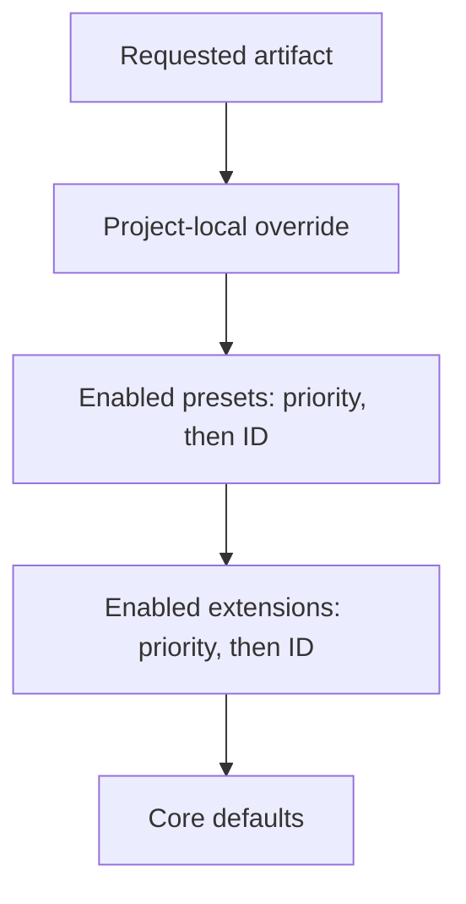

# 프리셋 API 레퍼런스

이 레퍼런스는 프리셋 매니페스트, 합성 및 전달 규칙, 설치 상태를 정의합니다.
터미널 명령은 CLI 레퍼런스가 문서화하고, 패키지를 만드는 과정은 개발 가이드가
안내합니다.

## 매니페스트

프리셋에는 루트가 YAML 매핑인 UTF-8 `preset.yml`이 있습니다.

| 필드 | 필수 | 계약 |
| --- | --- | --- |
| `schema_version` | 예 | 문자열 `"1.0"` |
| `preset` | 예 | 메타데이터 매핑 |
| `preset.id` | 예 | `[a-z0-9-]+`와 일치하는 문자열 |
| `preset.name` | 예 | 사람이 읽을 수 있는 문자열 |
| `preset.version` | 예 | Python `packaging.version.Version`이 받아들이는, 따옴표로 묶은 문자열 |
| `preset.description` | 예 | 설명 문자열 |
| `preset.author` | 아니요 | 작성자 메타데이터 |
| `preset.repository` | 아니요 | 저장소 URL 메타데이터 |
| `preset.license` | 아니요 | 라이선스 메타데이터 |
| `requires` | 예 | 요구 사항 매핑 |
| `requires.speckit_version` | 예 | 비어 있지 않은 문자열. 설치 중에 PEP 440 지정자로 확인됨 |
| `requires.extensions` | 아니요 | 확장 ID 또는 의존성 매핑의 목록 |
| `provides` | 예 | 기여 매핑 |
| `provides.templates` | 예 | 명령과 스크립트를 포함한, 비어 있지 않은 기여 매핑 목록 |
| `tags` | 아니요 | 탐색용 태그. 소문자 문자열 목록을 사용 |

게시하는 프리셋에는 설명적이고, 문자로 시작하며, 소문자와 하이픈으로 이루어진
ID와 `X.Y.Z` 버전을 사용하세요. 커뮤니티 제출 계약은 런타임 매니페스트 검증기보다
엄격합니다. `[a-z][a-z0-9-]*`와 일치하는 ID, 숫자 `X.Y.Z` 버전, 그리고 저장소,
문서, 라이선스, 릴리스 정보를 요구합니다. 런타임 메타데이터 검증만으로는 프리셋이
카탈로그 제출 요구 사항을 충족한다는 증명이 되지 않습니다.

버전과 제약은 따옴표로 묶으세요. `version: 1.0` 같은 YAML 값은 버전 문자열이
아니라 숫자입니다. 호환되지 않는 Spec Kit 버전이나 유효하지 않은 Spec Kit 지정자는
설치를 실패시킵니다.

### 기여 필드

`provides.templates`의 모든 항목은 다음 형태를 사용합니다.

```yaml
provides:
  templates:
    - type: "template"
      name: "spec-template"
      file: "templates/spec-addendum.md"
      description: "Adds team requirements"
      strategy: "append"
```

| 필드 | 필수 | 계약 |
| --- | --- | --- |
| `type` | 예 | `template`, `command`, `script` |
| `name` | 예 | 논리적 아티팩트 이름. 소스 파일명이 아님 |
| `file` | 예 | 프리셋 안의 상대 경로. 상위 디렉터리 순회 불가 |
| `description` | 아니요 | 기여 설명 |
| `strategy` | 아니요 | 기본값은 `replace`. 받아들인 문자열은 소문자로 정규화됨 |

템플릿과 스크립트 이름은 소문자, 숫자, 하이픈을 사용합니다.
명령 이름은 추가로 점을 허용합니다. `speckit.specify`나 `speckit.myext.report`
같은 이름을 사용하세요. 중복된 `(name, type)` 쌍은 거부되지만, 서로 다른 유형은
이름을 공유할 수 있습니다.

아티팩트가 선언되어 있으면 매니페스트의 `file`이 권위를 갖습니다. 선언된 경로가
없거나 파일이 아니더라도 같은 프리셋 안의 다른 관례적 파일로 폴백하지 않습니다.
선언된 모든 파일이 존재하도록 유지하세요. 매니페스트 구조 검증은 완전한 패키지
콘텐츠 검사가 아닙니다. 매니페스트가 없거나 요청된 이름을 선언하지 않은 경우에는
레거시 조회가 관례적 경로를 사용할 수 있습니다.

### 확장 의존성

```yaml
requires:
  speckit_version: ">=0.9.0"
  extensions:
    - "companion-extension"
    - id: "other-extension"
      version: ">=1.2.0,<2"
      required: false
```

단독 ID는 버전 제약 없이 필수임을 뜻합니다. 매핑 항목에는 `[a-z0-9-]+`와 일치하는
`id`가 필요합니다. 선택적인 `version`은 비어 있지 않은 유효한 PEP 440 지정자여야
하고, `required`는 불리언이어야 하며 기본값은 `true`입니다. 정확한 고정, 제외,
상한이 유효합니다.

의존성은 권고 사항이며 자동으로 설치되지 않습니다. 설치 후 CLI는 필수 확장이
없거나, 레지스트리 항목이 손상되었거나, 파일이 없거나, 비활성화되어 있거나, 비교
가능한 버전이 제약을 충족하지 않는 경우 경고합니다. 없거나 비활성화된 기능은
여전히 사용할 수 없습니다. 버전 불일치가 확장을 비활성화하지는 않습니다. 확장은
여전히 실행될 수 있으며 기대와 다르게 동작할 수 있습니다.

선택적 의존성에 대해서는 경고하지 않습니다. 파싱할 수 없거나 누락된 기록 버전은
비교 불가이며 불일치로 보고되지 않습니다. 레지스트리 항목 없이 해석기가 받아들인
확장 디렉터리는 사용 가능한 것으로 취급되지만 비교할 기록 버전이 없습니다. 확장
레지스트리를 읽을 수 없으면 이 설치 후 의존성 검사가 수행되지 않습니다. 경고가
없다고 해서 의존성이 검증되었다는 증명은 아닙니다.

의존성은 카탈로그 항목만이 아니라 매니페스트에 선언하세요. `--dev`와 `--from`은
카탈로그를 참조하지 않습니다. 자기 완결적인 네임스페이스 대체 명령은 비슷한 이름의
확장이 없어도 여전히 전달됩니다.

<a id="file-resolution"></a>

## 파일 해석

각 `(name, type)`은 독립적으로 평가됩니다.



프리셋 및 확장 레이어 안에서는 우선순위 숫자가 낮은 쪽이 이기고, 동률은 ID의
알파벳순으로 정해집니다. 비활성화된 항목은 제외됩니다. 안전한 미등록 확장
디렉터리는 암묵적 우선순위 `10`으로 참여합니다. 비활성화되었거나, 손상되었거나,
누락된 등록 확장은 미등록 기여로 다시 받아들여지지 않습니다.

| 유형 | 프로젝트 로컬 오버라이드 | 관례적 프리셋 하위 디렉터리 |
| --- | --- | --- |
| 템플릿 | `.specify/templates/overrides/<name>.md` | `templates/`. 레거시 루트 조회 포함 |
| 명령 | `.specify/templates/overrides/<name>.md` | `commands/` |
| 스크립트 | `.specify/templates/overrides/scripts/<name>.<ext>` | `scripts/` |

코어 조회에는 프로젝트 기본값과 패키지된 코어 자산, 또는 편집 가능/소스 설치의
경우 저장소 자산이 포함됩니다. 명령 조회는 `speckit.<stem>`을 코어 `<stem>.md`
파일명에 매핑할 수 있습니다. 덕분에 프로젝트에 `.specify/templates/commands/`
사본이 없어도 코어 명령을 기반으로 합성할 수 있습니다.

### 합성 전략

| 유형 | `replace` | `prepend` | `append` | `wrap` |
| --- | --- | --- | --- | --- |
| 템플릿 | 기본값 | 지원 | 지원 | `{CORE_TEMPLATE}` |
| 명령 | 기본값 | 지원 | 지원 | `{CORE_TEMPLATE}` |
| 스크립트 | 기본값 | 미지원 | 미지원 | `$CORE_SCRIPT` |

최상위 우선순위의 `replace` 레이어는 완전히 이깁니다. 그렇지 않으면 해석은 가장
가까운 하위 `replace` 기반을 찾아 그 위의 레이어만 아래에서 위로 적용합니다.
prepend와 append는 두 콘텐츠를 빈 줄로 구분합니다. 래퍼의 자리 표시자는 이미 다른
프리셋 사용자 정의를 담고 있을 수 있는 유효 하위 콘텐츠로 대체됩니다.

`replace` 기반이 없으면 합성은 출력을 만들 수 없습니다. 명령 등록은 네임스페이스만
보고 확장을 요구하는 대신, 합성할 수 없는 명령에 대해 경고하고 건너뜁니다. 필요한
자리 표시자가 없는 래퍼는 합성 중에 프리셋 검증 오류를 발생시킵니다.

합성된 명령 본문은 모든 레이어의 YAML 프런트매터를 담지 않습니다. 해석은 사용
가능한 최상위 우선순위 프런트매터를 사용하고, `scripts`, `agent_scripts`,
`argument-hint`가 없으면 기반에서 상속합니다. 내부 `strategy` 키는 합성 출력에서
제거됩니다. 그런 다음 활성 통합이 결과를 자신이 지원하는 명령 또는 스킬 형식으로
렌더링합니다.

## 명령과 스킬 라이프사이클

설치는 프리셋 파일을 `.specify/presets/<id>/`로 복사하고, 명령을 합성하기 전에
프리셋을 기록합니다. 최초 등록과 설치 후 조정이 유효 스택을 구체화하므로, 설치
순서가 최종적으로 이기는 명령을 결정하지 않습니다.

초기화된 프로젝트에서 전달은 기록된 활성 통합만을 대상으로 합니다. 스킬 모드는
명령 기반 통합에 대해 두 번째 명령 표현이 아니라 스킬을 내보냅니다. 네이티브 스킬
통합은 자신의 네이티브 형식을 사용합니다. generic 통합은 프리셋 오버라이드를
등록하지 않습니다.
`specify integration use <key>`나 `switch <key>`로 전환하면 새로 활성화된 통합에
대해 활성화된 프리셋이 다시 스캐폴딩됩니다.

`init-options.json`이 없는 레거시 프로젝트는 감지 기반 명령 등록을 유지합니다.
존재하지만 손상되었거나 형식이 잘못된 옵션 파일은 그 전체 에이전트 폴백을
트리거하지 않습니다.

제거는 기록된 출력을 정리하고 남은 프리셋, 확장, 오버라이드, 코어 기여를
조정합니다. 현재 통합뿐 아니라 제거된 프리셋이 기록한, 이전에 활성이었던 통합
디렉터리의 영향받는 명령 또는 스킬 출력도 복원할 수 있습니다. 활성화, 비활성화,
우선순위 변경은 해석 상태를 갱신하지만 이미 전달된 명령이나 스킬을 자체적으로 다시
스캐폴딩하지는 않습니다.

컨스티튜션 라이프사이클은 에이전트 명령 전달과 별개입니다. 기본적으로
컨스티튜션은 constitution 명령에 의해 해석되며, 스택이 바뀔 때마다 다시 쓰이지
않습니다. `constitution-sync`가 활성화되어 있으면 보호 장치가 있는 조정이 생성
콘텐츠 출처 정보를 사용해 직접 작성한 컨스티튜션을 덮어쓰지 않도록 합니다.

## 설치 상태

| 위치 | 역할 |
| --- | --- |
| `.specify/presets/<id>/preset.yml` | 설치된 매니페스트 |
| `.specify/presets/<id>/` | 복사된 패키지 파일 |
| `.specify/presets/.registry` | `schema_version: "1.0"`과 `presets` 매핑을 가진 JSON 레지스트리 |
| `.specify/presets/.cache/` | 카탈로그 캐시와 다운로드 작업 파일 |
| `.specify/memory/.constitution-template.json` | 구체화된 경우의 생성 컨스티튜션 출처 정보 |

레지스트리 메타데이터는 버전, 매니페스트 해시, 활성화 상태, 우선순위, 설치
타임스탬프, 소스, 등록된 명령/스킬 출력을 기록합니다. 현대적인 출력 추적은 통합
키를 이름 목록에 매핑합니다. 레거시 스킬 추적은 평면 목록일 수 있습니다. 이를
패키지 매니페스트나 안정적인 JSON 조회 API가 아니라 CLI가 관리하는 상태로
취급하세요.

카탈로그 설치는 `{"kind":"catalog","catalog":"<name>"}` 출처를 기록합니다.
로컬 디렉터리, 직접 URL, 로컬에 번들된 설치는 재사용 가능한 다운로드 URL이 아니라
로컬로 기록됩니다. 레지스트리 업데이트는 기존 `installed_at`을 보존하고, 제거 후
추가 방식의 교체는 새 값을 만듭니다.

## 스크립트 템플릿 해석

각 `common` 스크립트에 있는 Bash의 `resolve_template` /
`resolve_template_content`와 PowerShell의 `Resolve-Template` /
`Resolve-TemplateContent`가 셸 소비자에게 템플릿 해석을 노출합니다. 에이전트 명령
및 스킬의 구체화는 각 에이전트가 독립적으로 하는 것이 아니라 Spec Kit이
처리합니다.

## 함께 보기

- [프리셋 개요](overview.md)
- [CLI 레퍼런스와 JSON 출력](cli.md)
- [프리셋 개발하기](developing.md)
- [카탈로그 스키마와 설정](catalogs.md)
- [프리셋 게시하기](publishing.md)
- [아티팩트 목록과 합성 스택](../overview/artifacts.md)
- [통합 관리](../integrations/cli.md)
