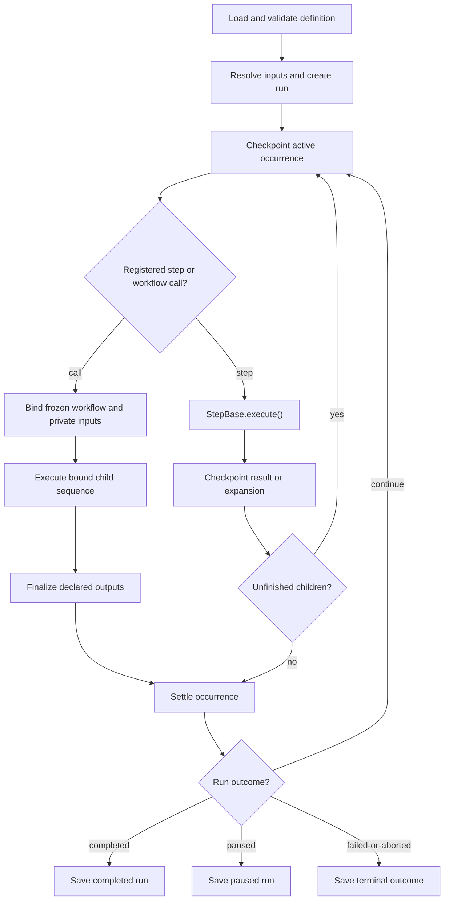
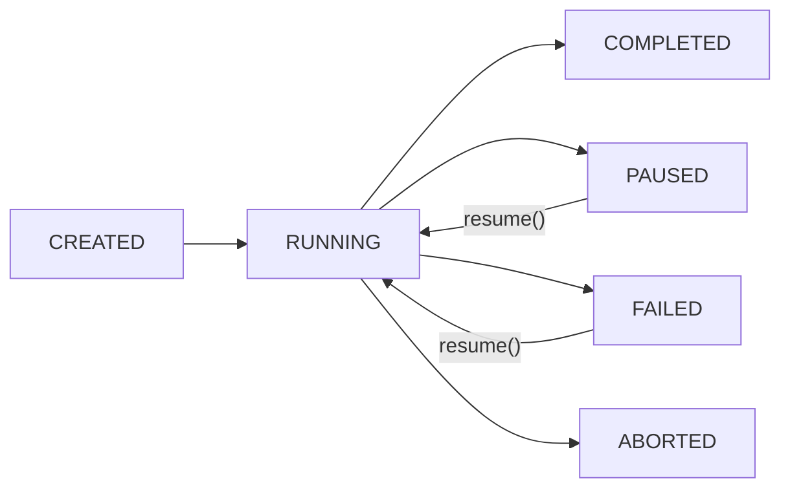

# 워크플로 API 레퍼런스

이 레퍼런스는 워크플로 YAML과 실행/상태 의미론을 설명합니다. CLI의 JSON 실행, 상태, 정의 인터페이스는 명령 레퍼런스에 문서화되어 있습니다.

<a id="workflow-yaml-schema"></a>

## 워크플로 YAML 스키마

| 필드 | 계약 |
| --- | --- |
| `schema_version` | 버전 `1.0`. 생략하면 `1.0`이 기본값 |
| `workflow` | 메타데이터와 디스패치 기본값 |
| `workflow.id` | 문자나 숫자로 시작하고 끝나는 소문자/숫자/하이픈. 한 글자 ID도 유효 |
| `workflow.name` | 필수이며 비어 있지 않은 문자열 |
| `workflow.version` | `X.Y.Z` 형식의 문자열. 생략하면 `0.0.0`이 기본값 |
| `workflow.author`, `workflow.description` | 설명용 메타데이터 |
| `workflow.integration`, `workflow.model` | 선택적인 문자열/null 디스패치 기본값 |
| `workflow.reasoning_effort`, `workflow.context_size` | `command` 및 `prompt` 스텝을 위한 선택적인 문자열/null 디스패치 기본값. 리터럴은 [값 규칙](../workflow-steps/types.md#reasoning-effort-and-context-size)을 따라야 함 |
| `workflow.options` | 기본 명령 스텝 `options`의 선택적 매핑/null. 스텝 출력에 기록되며 통합 CLI에는 전달되지 않음 |
| `requires` | `speckit_version`과 `integrations`만 받는 선택적 매핑 |
| `inputs` | 입력 정의의 매핑 |
| `outputs` | 선언된 워크플로 호출 출력의 매핑 |
| `steps` | 비어 있지 않은 스텝 정의 목록 |

`requires`는 권고 사항이며 샌드박스나 런타임 권한 게이트가 아닙니다. `requires.permissions`를 포함해 알 수 없는 키는 거부됩니다. 워크플로 기본값은 워크플로 호출 경계를 넘지 않습니다. 하위가 그것을 필요로 한다면 입력을 명시적으로 매핑하세요.

각 출력은 `value` 표현식을 선언합니다. 워크플로 호출 결과는 선언된 JSON 안전 값과 엔진이 소유한 상태 필드만 노출하며, 하위 입력, 내부 스텝 기록, 로그는 노출하지 않습니다.

<a id="input-types"></a>

## 입력 타입

워크플로 입력은 타입 검사를 거치며 CLI 문자열 값으로부터 변환됩니다.

```yaml
inputs:
  spec:
    type: string
    required: true
    prompt: "Describe what you want to build"
  task_count:
    type: number
    default: 5
  dry_run:
    type: boolean
    default: false
  scope:
    type: string
    default: "full"
    enum: ["full", "backend-only", "frontend-only"]
```

| 타입 | 받는 값 | 예시 |
|------|---------|---------|
| `string` | 모든 문자열 | `"user-auth"` |
| `number` | 숫자 문자열 → int/float | `"42"` → `42` |
| `boolean` | `true`/`1`/`yes` → `True`, `false`/`0`/`no` → `False` | `"true"` → `True` |

숫자 입력은 `2**53`을 넘는 값을 포함해 정수 값과 정수 문자열을 정확히 보존합니다. 소수/지수 문자열은 부동 소수점 변환을 사용하며, 정수 값을 갖는 결과는 정수로 저장됩니다. 불리언, 숫자가 아닌 값, 유한하지 않은 숫자는 거부됩니다. 필수 입력은 제공되거나 입력받아야 하며, 기본값과 enum 포함 여부가 검증됩니다.

<a id="execution-model"></a>

## 실행 모델

`specify workflow run`이 호출되면 정의를 로드해 검증하고, 입력을 해석하고, 루트
시퀀스를 실행합니다. 등록된 스텝과 워크플로 호출은 실행 건 라이프사이클 처리를
공유합니다.



### 순차 실행

스텝은 순차적으로 실행됩니다. 각 스텝은 해석된 입력, 누적된 스텝 결과, 워크플로 수준 기본값을 담은 `StepContext`를 받습니다. 실행 후 스텝의 출력은 `context.steps[step_id]`에 저장되고 `{{ steps.specify.output.file }}` 같은 표현식을 통해 이후 스텝에서 사용할 수 있게 됩니다.

### 중첩 스텝(제어 흐름)

`if`, `switch`, `while`, `do-while` 같은 스텝은 `next_steps`, 즉 엔진이 하위 실행
건으로 기록하는 인라인 정의를 반환합니다. 일반적인 중첩 분기는 주변의 표현식
컨텍스트를 공유합니다. 반면 팬아웃 항목은 독립적인 컨텍스트를 갖고, 워크플로 호출은
비공개 입력과 기본값을 바인딩합니다. 그 내부 별칭은 호출자의 컨텍스트로 들어오지
않습니다.

### 상태 영속화와 재개

엔진은 중단된 작업을 재개할 수 있도록 스텝 진행 상황을 디스크에 체크포인트합니다.



`gate`가 실행을 일시 정지하면 엔진은 입력과 스텝 결과를 유지합니다.
`specify workflow resume <run_id>` 시 완료된 실행 건은 다시 실행되지 않고 각자의
컨텍스트로 재생된 다음, 끝나지 않은 작업이 계속됩니다.

선택된 확장과 워크플로 바인딩은 하위 부수 효과보다 먼저 저장되고, 결과는 작업이
완료로 표시되기 전에 저장됩니다. 체크포인트가 실패하면 지속되는 진행 기록 없이
계속하는 대신 실행이 멈춥니다. 스텝은
[공개 스텝 API](../workflow-steps/api.md)를 통해 결과나 중첩 정의를 반환합니다.
체크포인트 전환을 관리하거나 비공개 실행 상태를 편집하지 않습니다.

<a id="execution-identity-and-resume"></a>

## 실행 정체성과 재개

각 스텝 실행 건은 영속화된 실행 트리 안에 기록 하나를 소유합니다. 작성된 스텝 ID는
로컬 표현식 별칭이지 전역 실행 ID가 아닙니다. 팬아웃 항목은 독립적인 별칭
컨텍스트와 순서가 유지되는 항목 결과를 갖습니다. 공개 보고는 필요한 곳에서 한정된
실행 건 ID를 사용합니다. 예를 들어 팬아웃 항목에는 `fan:template:0`, 이후의 루프
반복에는 `loop:step:1`입니다. 한정된 ID는 표현식 이름이 아닙니다. 팬아웃 항목
별칭은 보고 전용입니다. `fan-in`의 `wait_for`는 선언된 스텝 ID, 특히 팬아웃 스텝
자신의 `id`를 참조하며, 순서가 유지되는 항목 결과는
`steps.<fan-out-id>.output.results`로 사용할 수 있습니다.

> **마이그레이션 참고:** 팬아웃의 출력에는 더 이상 `step_template`이 포함되지
> 않습니다. `steps.<fan-out-id>.output`과 `fan-in`의 `output.results`에 있는
> 팬아웃 항목은 `items`, `max_concurrency`, `item_count`, `results`를 담습니다.
> 템플릿은 항목을 실행하는 비공개 실행 트리에만 유지됩니다.
> `{{ steps.<fan-out-id>.output.step_template }}` 같은 표현식은 이제 빈 값으로
> 해석됩니다. 대신 워크플로 정의에서 팬아웃의 `step`으로부터 템플릿을 읽으세요.

새 실행은 선택된 분기, 동적 사용자 정의 스텝 확장, 루프 반복, 팬아웃 항목을
영속화합니다. 재개는 이미 선택된 분기를 다시 평가하지 않고 완료된 작업을
유지합니다. 워크플로 대상과 오버레이로 해석된 정의는 설치가 바뀌더라도 바인딩된
채로 남습니다. 바인딩되지 않은 호출은 실행이 그곳에 도달했을 때 여전히 대상이
설치되고 활성화되어 있는지 확인합니다.

일반 재개는 바인딩된 입력을 유지합니다. 명시적인 `--input`은 도달했지만 완료되지
않은 호출을 원래의 매핑을 통해 다시 바인딩합니다. 새로 매핑된 값이 이전 바인딩을
재정의하고, 다시 매핑되지 않은 값은 바인딩된 값을 유지합니다.
완료된 호출은 결과를 유지합니다. 실패한 출력 평가는 완료된 하위 명령을 반복하지
않고 확정만 재시도합니다.

스냅샷은 워크플로 정의의 YAML 스칼라 타입을 보존합니다. 입력과 결과는 JSON 값으로
남습니다. 스냅샷은 정의와 확장을 동결할 뿐, `context.workflow_dir` 아래의 파일이나
스텝 구현을 동결하지 않습니다. 누락된 리소스는 여전히 일반적인 스텝 실패를 일으킬
수 있습니다. 레거시 실행은 저장된 진행 상황에서 재개됩니다. 재개는 `paused` 또는
`failed` 상태의 실행에만 사용할 수 있습니다.

`current_step_index`는 루트 시퀀스 인덱스이고, `current_step_id`는 스텝에 진입할
때마다 갱신되는 호환성용 실행 건 ID 뷰입니다. 정확한 활성 스텝 집합이 아닙니다.
병렬 팬아웃 중에는 이미 완료된 항목을 가리킬 수 있습니다. 한정된 값에는 팬아웃
항목의 `fan:item:0`과 이후 루프 반복의 `loop:body:1`이 있습니다.
워크플로 호출 안에서 ID는 호출된 워크플로 기준 상대적입니다. 구조화된 실행/상태
출력은 호출이 있을 때 `workflow_scopes` 요약을 포함하고, 활성인 중첩 게이트를 그
`scope_path`와 함께 보고합니다. 비공개 로그 필드나 실행 트리 내부에 의존하지 말고
[CLI의 구조화된 상태 및 정의 인터페이스](cli.md#workflow-status)를 사용해 진행
상황을 조회하세요.

## 오류 처리

기본적으로 런타임에 `StepResult(status=StepStatus.FAILED, ...)`를 반환하는 스텝은
실행 전체를 중단시킵니다. 가장 흔한 경우는 0이 아닌 코드로 종료하는 `shell` 또는
`command` 스텝입니다. 스텝에 `continue_on_error: true`를 설정하면 그 결과를
기록하고 다음 형제 스텝으로 계속 진행합니다. 실패가 0이 아닌 종료였다면 종료
코드는 `steps.<id>.output.exit_code`에 남아 있으므로, 이후의 `if`나 `switch`가
그에 따라 분기할 수 있습니다(또는 `gate`가 `message`의 `{{ }}` 보간을 통해
운영자에게 드러낼 수 있습니다).

```yaml
- id: heavy-thing
  type: command
  integration: claude
  command: speckit.heavy-thing
  continue_on_error: true

- id: check-result
  type: if
  condition: "{{ steps.heavy-thing.output.exit_code != 0 }}"
  then:
    - id: review
      type: gate
      message: "Step failed (exit {{ steps.heavy-thing.output.exit_code }}). Approve to run the recovery path, or reject to leave the failure recorded and move on."
      on_reject: skip
    - id: recover
      type: if
      condition: "{{ steps.review.output.choice == 'approve' }}"
      then:
        - id: rerun
          command: speckit.recovery
  else:
    - id: next-thing
      command: speckit.next-thing
```

이 예시에 대해 알아 둘 만한 점이 몇 가지 있습니다.

- 두 게이트 옵션(`approve`, `reject`) 모두 `StepStatus.COMPLETED`를 반환합니다.
  `on_reject: skip`은 엔진이 거부 시 중단하는지만 제어합니다(`skip`이면 중단하지
  않습니다). `then:` 목록의 이후 형제 스텝을 자동으로 건너뛰지는 **않습니다**.
  이후의 분기는 워크플로 작성자의 책임입니다. 위의 `recover` 스텝이 하듯이 후속
  `if`, `switch`, 또는 표현식에서 `{{ steps.<gate-id>.output.choice }}`를
  읽으세요.
- `on_reject`에는 세 가지 값이 있습니다. `abort`(기본값 — 거부 →
  `output.aborted = True`와 함께 `StepStatus.FAILED`, 실행을 중단), `skip`(거부 →
  `StepStatus.COMPLETED`, 작성자가 위와 같이 분기를 처리), `retry`(거부 →
  `StepStatus.PAUSED`, 다음 `specify workflow resume`이 게이트를 다시 실행)입니다.
- 게이트는 실패한 스텝을 자동으로 다시 실행하지 않습니다. 재시도 경로를 표현하려면
  사용자 정의 게이트 옵션을 정의하고 이후에 선택에 따라 분기하거나, 실패하는
  스텝을 직접 만든 루프로 감싸세요.

**참고:**

- 이 필드는 리터럴 불리언(`true` / `false`)이어야 합니다. `"true"` 같은 변환
  문자열은 검증 시 거부됩니다.
- **범위: 반환된 실패만.** 이 플래그는 `status=StepStatus.FAILED`인 스텝 결과에
  적용됩니다. 스텝의 `execute()` 메서드 밖으로 던져진 처리되지 않은 예외는 엔진이
  보고하며 `continue_on_error`와 무관하게 실행을 중단시킵니다. 스텝 작성자가
  예외 경로에도 이 플래그가 적용되기를 원한다면, 스텝이 내부적으로 예외를 잡아
  실패를 `output`에 인코딩한(예: `exit_code`, `stderr`, 또는 사용자 정의 필드)
  `StepResult(status=StepStatus.FAILED, ...)`를 반환해야 합니다.
- 게이트 중단(운영자가 선택한 `on_reject: abort`)은 항상 실행을 멈춥니다.
  `continue_on_error`가 이를 재정의하지 않습니다. 이 플래그는 일시적이거나 예상된
  스텝 실패를 위한 것이지, 운영자의 의도적인 결정을 뒤집기 위한 것이 아닙니다.
- 구조 검증은 미리 실행됩니다. `specify workflow run`은 실행이 만들어지기 전에
  유효하지 않은 워크플로 정의를 거부하므로, 검증 실패는 이 코드 경로에 도달하지
  않습니다.
- 플래그가 생략되었거나 false이면 반환된 실패가 실행을 멈춥니다.

## 상태와 재개

각 워크플로 실행은 `.specify/workflows/runs/<run_id>/`에 상태를 영속화합니다.

- `state.json` — 각 스텝의 출력을 포함한 현재 실행 상태와 스텝 진행 상황.
  [`capture: true`](../workflow-steps/types.md#capturing-command-and-prompt-output)로
  캡처된 출력은 여기에 일반 텍스트로 저장됩니다.
- `inputs.json` — 해석된 입력 값
- `log.jsonl` — 스텝별 실행 로그

이를 통해 `specify workflow resume`은 완료된 실행 건을 재생하고, 실행이 일시
정지했거나(예: 게이트에서) 실패한 끝나지 않은 실행 건에서 계속할 수 있습니다.

## 상태 및 설정 위치

| 컴포넌트 | 위치 | 형식 | 용도 |
|-----------|----------|--------|---------|
| 워크플로 정의 | `.specify/workflows/{id}/workflow.yml` | YAML | 설치된 워크플로 정의 |
| 워크플로 레지스트리 | `.specify/workflows/workflow-registry.json` | JSON | 설치된 워크플로 메타데이터 |
| 프로젝트 오버레이 | `.specify/workflows/overlays/{id}/*.yml` | YAML | 프로젝트 로컬 워크플로 편집 |
| 실행 상태 | `.specify/workflows/runs/{run_id}/state.json` | JSON | 영속화된 실행 상태 |
| 실행 입력 | `.specify/workflows/runs/{run_id}/inputs.json` | JSON | 해석된 입력 값 |
| 실행 로그 | `.specify/workflows/runs/{run_id}/log.jsonl` | JSONL | 추가 전용 이벤트 로그 |
| 카탈로그 캐시 | `.specify/workflows/.cache/*.json` | JSON | 캐시된 카탈로그 항목(TTL 1시간) |
| 프로젝트 카탈로그 | `.specify/workflow-catalogs.yml` | YAML | 프로젝트 수준 카탈로그 소스 |
| 사용자 카탈로그 | `~/.specify/workflow-catalogs.yml` | YAML | 사용자 수준 카탈로그 소스 |

## 함께 보기

- [워크플로 CLI와 JSON 계약](cli.md)
- [작성과 번들된 예시](developing.md)
- [내장 스텝 설정](../workflow-steps/types.md)
- [표현식](expressions.md)
- [카탈로그 스키마](catalogs.md)
- [스텝 Python API 레퍼런스](../workflow-steps/api.md)
