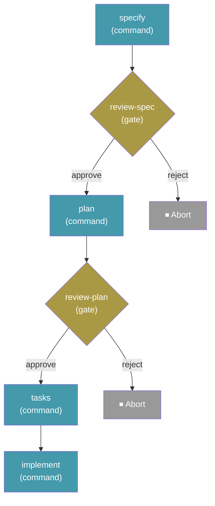

# 워크플로 개발하기

워크플로 패키지는 `workflow.yml` 정의와 그것이 참조하는 스크립트, 모듈, 리소스를 담습니다. 작은 로컬 정의로 시작해 성공 및 실패 경로를 실행해 본 다음, 버전이 지정된 릴리스로 패키징하세요.

## 패키지 구조

```text
my-workflow/
├── workflow.yml
├── README.md
├── LICENSE
├── CHANGELOG.md
└── scripts/
```

단순한 워크플로에는 YAML 파일 하나면 충분합니다. 디렉터리와 아카이브 설치는 동반 파일을 보존합니다. 원시 YAML URL은 인접한 저장소 파일을 다운로드하지 않습니다. 아카이브는 패키지를 루트 또는 하나의 최상위 디렉터리 안에 담을 수 있습니다.

동반 파일은 호출자의 작업 디렉터리가 아니라 `context.workflow_dir` 또는 셸의 `SPECKIT_WORKFLOW_DIR`로 해석하세요.

## 번들된 SDD 예시

워크플로는 YAML 파일로 정의합니다. 다음은 Spec Kit과 함께 제공되는 내장 **Full SDD Cycle** 워크플로입니다.

```yaml
schema_version: "1.0"
workflow:
  id: "speckit"
  name: "Full SDD Cycle"
  version: "1.0.2"
  author: "GitHub"
  description: "Runs specify → plan → tasks → implement with review gates"

requires:
  speckit_version: ">=0.15.1"
  integrations:
    any:
      - "alquimia"
      - "claude"
      - "copilot"
      - "gemini"
      - "opencode"

inputs:
  spec:
    type: string
    required: true
    prompt: "Describe what you want to build"
  integration:
    type: string
    default: "auto"
    prompt: "Integration to use (e.g. claude, copilot, gemini; 'auto' uses the project's initialized integration)"
  speckit_review_spec_verdict:
    type: string
    default: ""
  speckit_review_plan_verdict:
    type: string
    default: ""

steps:
  - id: specify
    command: speckit.specify
    integration: "{{ inputs.integration }}"
    input:
      args: "{{ inputs.spec }}"

  - id: review-spec
    type: gate
    verdict_input: speckit_review_spec_verdict
    message: "Review the generated spec before planning."
    options: [approve, reject]
    on_reject: abort

  - id: plan
    command: speckit.plan
    integration: "{{ inputs.integration }}"
    input:
      args: "{{ inputs.spec }}"

  - id: review-plan
    type: gate
    verdict_input: speckit_review_plan_verdict
    message: "Review the plan before generating tasks."
    options: [approve, reject]
    on_reject: abort

  - id: tasks
    command: speckit.tasks
    integration: "{{ inputs.integration }}"
    input:
      args: "{{ inputs.spec }}"

  - id: implement
    command: speckit.implement
    integration: "{{ inputs.integration }}"
    input:
      args: "{{ inputs.spec }}"
```

이 정의는 다음 실행 흐름을 만듭니다.



다음으로 실행합니다.

```bash
specify workflow run speckit -i spec="Build a kanban board with drag-and-drop task management"
```

## 로컬에서 테스트하기

```bash
specify workflow run ./workflow.yml --input key=value
specify workflow status <run_id>
specify workflow resume <run_id>
specify workflow add ./my-workflow --dev
specify workflow info my-workflow
```

`run`은 실행 전에 검증한 다음 정의를 실행합니다. 드라이 런 검증기가 아닙니다. 파일을 수정하거나 에이전트를 호출할 수 있는 예시에는 일회용 초기화 프로젝트를 사용하세요. `specify workflow validate` 명령은 없습니다. `info`는 메타데이터와 스텝을 표시할 뿐, 완전한 안전성 검토가 아닙니다.

해당하는 경우 유효한 입력과 유효하지 않은 입력, 게이트 판정과 거부 정책, 스텝 실패, 중단/실패 후 재개, 중첩 호출, 동시 항목을 다루세요. 완료된 스텝은 재개 시 반복되지 않지만 체크포인트되지 않은 부수 효과는 반복될 수 있습니다. 외부 쓰기를 안전하게 재시도할 수 있게 만드세요.

## 작성 실무

- 스텝은 초점을 좁게 유지하고 게이트는 의미 있는 결정 지점에 두세요.
- 입력에는 설명적인 프롬프트, 알맞은 타입, 합리적인 기본값, 그리고 고정된 선택지에는 enum을 부여하세요.
- 통합 기본값을 선언하고 스텝별 재정의를 허용하세요. `requires.integrations`는 기대 사항을 문서화할 뿐, 강제되는 권한이 아닙니다.
- 이전 스텝의 출력은 그 스텝이 실행된 뒤에만 읽으세요. `default`는 null이나 빈 텍스트를 처리할 뿐, 가능한 모든 표현식 오류를 처리하지는 않습니다.
- 동적 데이터에는 환경 바인딩을 쓰는 strict 셸 스텝을 우선하세요. 파괴적인 작업, 자격 증명, 네트워크 호출, 그 밖의 부수 효과를 문서화하세요. 게이트가 신뢰할 수 없는 셸 텍스트를 안전하게 만들지는 않습니다.

## 함께 보기

- [워크플로 YAML과 실행 의미론](api.md)
- [내장 스텝 타입](../workflow-steps/types.md)
- [표현식과 셸 안전성](expressions.md)
- [워크플로 게시하기](publishing.md)
- [사용자 정의 스텝 패키지 개발하기](../workflow-steps/developing.md)
